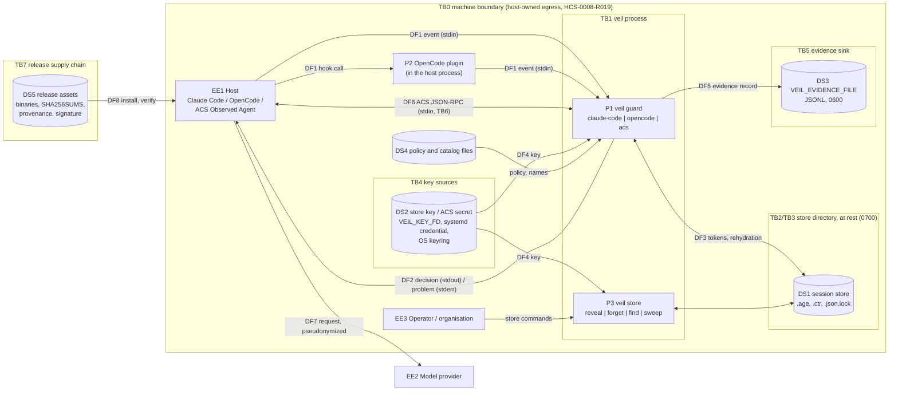

# veil threat model

What veil protects against, what it does not, and the test that proves each
claim. Privacy threats follow **LINDDUN**, security threats follow
**STRIDE**, both over one data-flow diagram of veil running as a guard.

- **Scope.** veil as a guard between an agent host and the model provider
  (`veil claude-code`, `veil opencode`, `veil acs`), the OpenCode plugin,
  the `veil store` commands, the pseudonym store and its keys, the evidence
  file, the policy and catalog files, and the release supply chain. The
  host, the model provider and the organisation running veil are external
  entities: their threats appear only where veil depends on them, with the
  owner named.
- **Status.** Every row is one of:
  - `mitigated`: veil enforces it, and the named tests prove it;
  - `accepted`: a residual risk decided on purpose, with the reason and the
    owner (the host, the organisation, or a tracking issue);
  - `open`: a known gap, with its issue.
- **Mitigation references** are `file:line` at the time of writing, followed
  by the symbol, which is authoritative when lines move.
- **Kept honest by a test.** `docs/threatmodel_test.go` (in `go test ./...`,
  so CI runs it) fails if a test named here does not exist in a Go or JS
  test file, if a row's status is not one of the three, if a `mitigated`
  row names no test, if an `open` row links no issue, or if a referenced
  file or symbol is gone. The tests themselves run in the same CI job.

## Methodology and sources

- **LINDDUN** (DistriNet, KU Leuven): the seven threat types and the
  privacy threat trees, <https://linddun.org/threat-types/> and
  <https://linddun.org/threat-trees/>. Rows cite the tree node they
  instantiate (for example `L.1.1` Unique identifier, `DD.3.4`
  Duration/retention), from the "latest" basic trees, dated 2024-12-03.
  The method is LINDDUN PRO style: each DFD element is checked against
  each tree. Not verified: whether a newer tree version exists outside the
  "latest" download path.
- **STRIDE**: the definitions in Microsoft's Threat Modeling Tool,
  <https://learn.microsoft.com/en-us/azure/security/develop/threat-modeling-tool-threats>,
  and the OWASP Threat Modeling Cheat Sheet,
  <https://cheatsheetseries.owasp.org/cheatsheets/Threat_Modeling_Cheat_Sheet.html>
  (Spoofing, Tampering, Repudiation, Information disclosure, Denial of
  service, Elevation of privilege), applied per DFD element.
- **Requirements.** HCS 0.1.0-draft.11 (the HagaHarness Conformance
  Specification veil fits as a guard): HCS-0005-R010 to R015 (decision
  records, approvals), HCS-0006-R002 (error codes), HCS-0008-R011/R012
  (secrets) and HCS-0008-R019/R020 (guard on model requests). GDPR
  articles 5(1)(c) (minimisation), 5(1)(e) (storage limitation), 15
  (access), 17 (erasure), 25 (by design and by default) and 32 (security
  of processing). veil supplies mechanisms; meeting an article stays the
  organisation's job.

## Data-flow diagram

| Boundary | What crosses it |
| --- | --- |
| TB0 | Everything that leaves the machine. Only the host sends to the provider; egress that bypasses veil is the host's (HCS-0008-R019). |
| TB1 | Host to veil: an event on stdin, a decision on stdout, a problem on stderr, an exit code. The OpenCode plugin runs inside the host and spawns veil per hook. |
| TB2 | veil to the store: session files named after the host's session id. |
| TB3 | The store at rest: backups, sync clients, other applications, an agent's own file tools. |
| TB4 | Key sources: an inherited descriptor, a systemd credential, the OS keyring. |
| TB5 | Evidence sink: a JSONL file the host reads. |
| TB6 | ACS JSON-RPC over stdio with an Observed Agent, optionally HMAC-signed. |
| TB7 | Release supply chain: GitHub Actions builds, signs and publishes; the host verifies and installs. |

## LINDDUN (privacy)

| ID | Tree | Element | Threat | Mitigation | Test | Status | Maps to |
| --- | --- | --- | --- | --- | --- | --- | --- |
| L1 | L.1.1 | DF7, DS1 | A marker such as `[DNI-001]` becomes an identifier that links one person across sessions. | Marker numbering is per session and never shared: `internal/pseudonymstore/file.go:121` (`Token`). | `TestMemoryPseudonymStore_DifferentSessions_AreIsolated`, `TestFileStore_DifferentSessions_UseSeparateFiles` | mitigated | GDPR 25 |
| L2 | L.1.1 | DF7 | Within one session the same value always gets the same marker, so the provider links every mention of one person. | By design: the agent needs one stable name per value to work (pseudonymisation, GDPR art. 4(5), not anonymisation). | `TestPolicy_Evaluate_SameOriginal_AcrossTwoEvents_SameSession_IsStable` | accepted: required for utility; the organisation decides whether pseudonymised data may reach the provider | GDPR 25, 32 |
| L3 | L.1.1 | DF1, DS1 | Distinct session ids share one store file (`a/b`, `a\b`, `a..b` and `a_b`; an empty id and `unknown-session`), so a marker minted in one session rehydrates in the other and unrelated conversations are linked. | Session ids name files injectively: RFC 4648 base32 of the id, or a prefix plus its SHA-256 when too long (`internal/pseudonymstore/naming.go:106` (`encodeStem`)); an empty id fails closed with `VEIL_SESSION_ID_MISSING`; a pre-#26 file several ids shared is never read for any of them, only its counters seed theirs (`internal/pseudonymstore/migrate.go:26` (`migrate`)). | `TestFileStore_DistinctSessionIDs_NeverShareAMapping`, `TestFileStore_EmptySessionID_FailsClosed`, `TestRun_MissingSessionID_FailsClosedOnEveryHost`, `TestMigration_AmbiguousLegacy_IsNeverMerged`, `TestMigration_UnambiguousLegacy_KeepsItsMarkers` | mitigated | HCS-0008-R019, GDPR 32 |
| L4 | L.2.1.1 | DF7 | Context left in clear (job, address, dates, a rare condition) works as a quasi-identifier that links or singles out a person. | None: veil's detectors are patterns for structured values. NER is under study in #3. | `TestCorpus_MeetsBaseline` (pins the known misses) | accepted: regex detectors miss unstructured data; owner #3 | GDPR 5(1)(c) |
| I1 | I.1.1 | DF1, DF7 | A DNI/NIE, IBAN, email, phone or catalog name in a prompt, tool arguments, tool output (OpenCode, ACS), history or system prompt (OpenCode) reaches the provider. | Every event is evaluated and rewritten before the host sends it: `internal/domain/policy.go:80` (`Evaluate`). | `TestLeak_DNIInToolArgument_IsRewritten`, `TestLeak_DNIInPrompt_OnClaudeCode_IsRewritten`, `TestLeak_DNIInPrompt_OnOpenCode_IsRewritten`, `TestRoundTrip_ToolExecuteAfter_DNIInOutput_IsRewritten`, `TestRoundTrip_MessagesTransform_DNIInHistory_IsRewritten`, `TestRoundTrip_SystemTransform_DNIInSystemPrompt_IsRewritten`, `TestRun_ACS_SpanishCorpus_NeverPassesInClear` | mitigated | HCS-0008-R019, GDPR 5(1)(c), 25 |
| I2 | I.1.1 | DF1 | The same value written so a pattern misses it: separators, `+34`, full-width digits, zero-width characters, digits of other scripts. | Separated forms and a lookalike view (NFKC, Default_Ignorable removed): `internal/domain/lookalike.go:65` (`newLookalikeView`), `internal/domain/detector.go:70` (`DetectAll`). | `TestSeparatedForms_AreDetectedWithCompactKey`, `TestRegistry_DetectAll_Lookalikes`, `TestRun_ClaudeCode_Lookalikes_Rewritten`, `TestRun_OpenCode_Lookalikes_Rewritten`, `TestRun_ACS_UnicodeLookalikes_ArePseudonymized` | mitigated | GDPR 25 |
| I3 | I.1.1 | DF1 | A catalog name joined to another name part (`Juan García-López`), or two overlapping catalog names replaced in map order, leaves part of a name in clear. | Joined parts extend the span; one pass, longest match first: `internal/domain/policy.go:200` (`substituteAll`). | `TestNameCatalogDetector_JoinedSurnameExtendsSpan`, `TestPolicy_JoinedSurname_NoLeakNoSharedToken`, `TestPredict_LongestMatchWins` | mitigated | GDPR 5(1)(c) |
| I4 | I.1.1 | DF1 | Names outside the catalog and identifiers with no fixed shape are not detected. | None in veil: no NER. Known misses are measured by the corpus gate. | `TestCorpus_MeetsBaseline` | accepted: regex detectors miss unstructured data; owner #3 | GDPR 5(1)(c) |
| I5 | I.1.2 | DF6 | Personal data in ACS metadata, a member name, `tool.name` or `raw_command`, where no ACS modification can replace it. | Every leaf and member name of `params` is scanned; what cannot be rewritten is denied with `VEIL_ACS_UNREDACTABLE`: `internal/hosts/acs/v0_1/decode.go:245` (`scan`), `internal/hosts/acs/v0_1/adapter.go:127` (`errUnredactable`). | `TestDecodeHook_ScansEveryLeafAndMemberName_ButTheStructuralFields`, `TestAnswer_PersonalDataAnywhereInParams_NeverPassesInClear` | mitigated | HCS-0008-R019 |
| I6 | I.1.1 | DF1 | Tool output veil cannot read (binary bytes, a long base64 blob) carries personal data past the detectors. | Denied outright, never scanned: `internal/domain/binarycontent.go:33` (`Detect`). | `TestBinaryContentDetector_InvalidUTF8_IsHardDenied`, `TestBinaryContentDetector_LongBase64Blob_IsHardDenied`, `TestRoundTrip_ToolExecuteAfter_BinaryOutput_IsDenied` | mitigated | GDPR 25 |
| I7 | I.2.1.1, I.2.3 | DF7 | A marker plus context singles out a person when the set of possible people is small (a small client base). | None: the provider still holds pseudonymised personal data. | none | accepted: pseudonymisation is not anonymisation (README, "The pseudonym store"); the organisation assesses it (DPIA) | GDPR 25, 32 |
| NR1 | Nr.1.1, Nr.1.3 | DS3, DF2 | Decision evidence attributes data to a person: values, hashes, field names or text in the record. | The record holds the session id, the time, detector ids, DPV categories and counts, never content: `internal/evidence/evidence.go:223` (`Build`). | `TestCorpus_NoEvidenceLeaks`, `TestRun_Evidence_NeverCarriesInput` | mitigated | HCS-0005-R010, R011 |
| NR2 | Nr.1.3 | DF2 | A failure's problem line carries a detected value, a path or a session id to host logs. | Fixed `title`/`detail` per type: `internal/problem/problem.go:238` (`Write`). | `TestRun_FailureProblems_NeverCarryDetectedValues`, `TestWrite_EmitsOneProblemJSONLineWithoutStatus` | mitigated | HCS-0006-R002, GDPR 5(1)(c) |
| NR3 | Nr.1.2 | DF6 | A signed ACS response binds a decision to a session key. | Signing is opt-in by the host; a response carries markers and pointers, never a detected value. | `TestAnswer_SignedKnownAnswer_VerifiesAndSignsTheResponse` | accepted: integrity of decisions is the purpose; owner host (opt-in) | none |
| DE1 | D.3 | DS1 | The store directory shows which session ids exist, and a counters file kept after `forget` shows how many values of each category a session saw. | Counters hold no value, marker or mapping; they stop marker reuse (see T9). | `TestRemovedSession_KeepsOnlyCounters` | accepted: counters file kept after `forget` (no values) | GDPR 17 |
| DE2 | D.3 | P3 | `veil store find` reveals which sessions hold a value. | Needs the key and fails closed with no partial list; the value can come from stdin, out of argv: `internal/pseudonymstore/retention.go:174` (`Find`). | `TestFind_WrongOrMissingKey_FailsClosed`, `TestRun_StoreFind_MissingOrWrongKey_FailsClosed`, `TestRun_StoreFind_ValueFromStdin` | mitigated | GDPR 15, 32 |
| DE3 | D.2, D.3 | DS3, DF2 | A deny, or an evidence record's categories and counts, tells whoever reads it that personal data or a secret was present. | Inherent to a guard: a deny must be visible and HCS-0005-R010 needs a record. The evidence file is created 0600. | `TestAppend_OneLinePerRecord` | accepted: the record is required; owner host (who reads the sink) | HCS-0005-R010 |
| DD1 | DD.3.2, DD.4.1 | EE1 (Claude Code) | Claude Code cannot redact tool output, history or the system prompt (no hook for it), so those reach the provider unfiltered. | veil refuses to claim it: asking for an unsupported capability is an error, never a silent allow: `internal/domain/capability.go:143` (`RequireCapability`). | `TestLeak_ToolOutput_OnClaudeCode_IsNeverSilentlyAllowed`, `TestCapabilityMatrix_MatchesVerifiedHostBehavior` | accepted: host capability; owner host | HCS-0008-R019 |
| DD2 | DD.3.2 | TB0 | A process of the run (a tool, an MCP server, a code-execution tool) sends data to a provider without going through veil. | None in veil: reachability is a host property. | none | accepted: owner host (HCS-0008-R019/R020; HagaHarness #251 per #12) | HCS-0008-R019, R020 |
| DD3 | DD.3.4 | DS1 | The store keeps personal data longer than needed. | `store.ttl` deletes sessions unused for longer than the TTL, at every start (bounded) and with `veil store sweep`: `internal/pseudonymstore/retention.go:45` (`Sweep`). Without a TTL nothing is deleted. | `TestSweep_RemovesExpiredSession_KeepsUnexpiredOne`, `TestRun_StartupSweep_RemovesExpired`, `TestRun_NoTTL_DeletesNothing`, `TestRetention_TTLFromStoreMember` | mitigated | GDPR 5(1)(e) |
| DD4 | DD.4.2 | DS1, TB3 | Backups, sync clients, other applications or an agent's own file tools read the store. | age v1 encryption to an X25519 key held apart, files 0600, directory 0700, v1 plaintext migrated: `internal/pseudonymstore/file.go:495` (`save`), `internal/pseudonymstore/dir_unix.go:17` (`securePrivateDir`). | `TestFileStore_SessionFile_HoldsNoRealValueOrKey`, `TestFileStore_DifferentSessions_UseSeparateFiles`, `TestFileStore_ExistingSessionsDir_IsTightenedTo0700`, `TestFileStore_MigratesV1Plaintext_AndRemovesIt` | mitigated | GDPR 32 |
| DD5 | DD.4.2 | DS1, DS2 | A process of the same user that obtains the key (asks the keyring, reads memory) reads the store. | None in veil. The host keeps the run's processes away from the key and the keyring and passes the key by descriptor only to veil. | none | accepted: same-user process with the key; owner host (sandbox) | HCS-0008-R012, GDPR 32 |
| DD6 | DD.3.3 | DF1 | A real value is written back somewhere it can leave: rehydration in a tool that is not a file write (a shell command, a web call). | Only write/edit/multiedit/patch rehydrate: `internal/domain/policy.go:98` (`isWriteTool`). | `TestPolicy_Evaluate_NonWriteTool_DoesNotRehydrate`, `TestPolicy_Evaluate_WriteTool_RehydratesKnownTokens` | mitigated | GDPR 5(1)(c) |
| DD7 | DD.3.3 | P2 | OpenCode stores a second copy of a tool's output in `metadata.output`, so redacting only `output` leaves the value on local disk. | The plugin replaces both, on rewrite and on failure: `adapters/opencode/veil-plugin.js:238` (`metadata.output`). | `a rewrite of tool output also replaces the copy OpenCode stores in metadata`, `a failure on tool output withholds the output instead of leaking it` | mitigated | GDPR 32 |
| DD8 | DD.3.4 | DS1 | A deleted session survives on the medium (SSD, journaling filesystem). | Deletion is durable (directory fsync) and what survives is age ciphertext. Destroying the key crypto-erases every session (NIST SP 800-88 Rev. 2). | `TestRemoval_IsDurable` | accepted: unlinking is not media sanitization; owner organisation | GDPR 17, 32 |
| U1 | U.1.2 | EE1 | The person using the agent does not know what veil hid from the model. | `veil store reveal` gives the host a "what veil hid" view; the chat shows markers, not silence: `internal/pseudonymstore/file.go:189` (`Reveal`). | `TestRun_StoreReveal_ListsWhatVeilHid`, `TestFileStore_Reveal_ListsMarkersInOrder` | mitigated | GDPR 25 |
| U2 | U.1.1 | EE3 | Data subjects are not told their data is pseudonymised and sent to a provider. | None in veil. | none | accepted: transparency is the organisation's obligation | GDPR 25 |
| U3 | U.2.2 | P3 | An access request cannot find where a value is held. | `veil store find` matches a value however it was written: `internal/pseudonymstore/retention.go:174` (`Find`). | `TestFind_ListsSessionsAndCategoriesHoldingTheValue`, `TestRun_StoreFind_MatchesCompactAndSeparatedForms_PrintsNoValue` | mitigated | GDPR 15 |
| U4 | U.2.3 | P3 | An erasure request is blocked, for example by a lost key. | `forget` and `sweep` need no key, take the lock, and sync the directory: `internal/pseudonymstore/file.go:219` (`Forget`). | `TestRun_StoreForget_SeveralSessions_NeedsNoKey`, `TestSweep_NeedsNoKey`, `TestRemoval_IsDurable` | mitigated | GDPR 17 |
| U5 | U.2.2, U.2.3 | P3 | The same phone written bare and with `+34` gets two markers, and `find --value 600123456` misses a session that saw `+34 600 123 456`, so an access or erasure request can be incomplete. Nothing leaks to the provider. | Every written form of a Spanish phone is keyed by its ITU-T E.164 form, so it is one marker and `find` matches it however it is written. Markers an existing session already holds keep their meaning. | `TestPolicy_OnePhoneEveryForm_OneMarker`, `TestPolicy_ExistingSessionPhoneMarkers_KeepTheirMeaning`, `TestRun_OpenCode_OnePhoneEveryForm_OneMarker`, `TestRun_ClaudeCode_OnePhoneEveryForm_OneMarker`, `TestRun_ACS_OnePhoneEveryForm_OneMarker` | mitigated | GDPR 15, 17 |
| U6 | U.2.3 | EE1, EE3 | The same data stays in host transcripts, logs and backups after `forget`. | None in veil: it erases only its own store. | none | accepted: owner organisation and host (README, "Retention and data subject requests") | GDPR 17 |
| NC1 | Nc.1.1.2 | P1 | More personal data is sent than needed. | The embedded default policy rewrites every rewritable category; a policy can only enable detectors veil ships: `internal/policy/policy.go:189` (`Load`). | `TestDefault_Registry_IsBuiltInDetectorSet`, `TestRun_DefaultPolicy_Equivalence` | mitigated | GDPR 5(1)(c), 25 |
| NC2 | Nc.1.1.4 | DS1 | Storage limitation depends on a retention period nobody set. | The mechanism exists (DD3); with no TTL veil deletes nothing so an upgrade never removes data. | `TestRetention_DefaultKeepsEverything` | accepted: the period is the organisation's decision | GDPR 5(1)(e) |
| NC3 | Nc.4 | DS3 | A decision record cannot tell which catalog of names was in force. | The policy digest covers the catalog path; the names themselves are traced only through the host's `VEIL_CATALOG_REVISION` (a hash of a short name list can be reversed): `internal/evidence/evidence.go:316` (`ValidateRevision`). | `TestRun_CatalogRevision`, `TestRun_Evidence_PolicyFingerprint` | accepted: catalog traced only via host-supplied `VEIL_CATALOG_REVISION` | HCS-0005-R010, R011 |
| NC4 | Nc.3 | P1 | A failure (policy, catalog, store, key, evidence) lets an event through. | Every failure is a typed problem and blocks the event: `cmd/veil/main.go:173` (`fail`). | `TestRun_Failures_ReportOneProblemAndTheExitClass`, `TestFail_EveryCode_WritesItsTypeAndExitsWithTheHostFailureCode` | mitigated | HCS-0005-R014, HCS-0008-R020, GDPR 32 |

## STRIDE (security)

| ID | Element | Threat | Mitigation | Test | Status | Maps to |
| --- | --- | --- | --- | --- | --- | --- |
| S1 | DF6 | A request forged or altered on the ACS channel. | With a secret configured, every request but `system/ping` must carry a valid HMAC-SHA256 over its JCS form; signed requests without a secret are refused: `internal/hosts/acs/v0_1/adapter.go:168` (`verify`). | `TestAnswer_SignedKnownAnswer_VerifiesAndSignsTheResponse`, `TestAnswer_FailsClosedWithItsCode`, `TestDeriveKey_SpecificationExample` | mitigated | none |
| S2 | DF6 | A recorded ACS request replayed. | `request_id` remembered per session within one process until its timestamp leaves the 5-minute window: `internal/hosts/acs/v0_1/adapter.go:211` (`checkReplay`), `internal/hosts/acs/v0_1/adapter.go:198` (`checkTimestamp`). | `TestAnswer_ReplayedRequestID_IsRefused`, `TestAnswer_ForgetsRequestIDsPastTheSkewWindow` | mitigated | none |
| S3 | DF6 | A replay across `veil acs` processes or in bare one-message mode, and no audit chain (`chain_hash`). | Only the timestamp window applies. | none | accepted: stateless by design (ACS divergence, #20); owner host | none |
| S4 | DF6 | Model or tool text poses as a person's approval. | veil never answers `ask` or `defer`; only the host takes a person's answer: `internal/hosts/acs/v0_1/adapter.go:243` (`hello`). | `TestAnswer_NeverEmitsAskDeferOrAnImplicitAllow` | mitigated | HCS-0005-R014, R015 |
| S5 | DF4 | A different key is substituted: a descriptor below 3 (veil's own stdin/stdout/stderr), or a broken host descriptor that silently falls back to the keyring. | The host key always wins and never falls back; descriptors below 3 are refused: `internal/pseudonymstore/keys.go:132` (`fd < 3`). | `TestFileStore_HostFDBelowThree_IsInvalid`, `TestFileStore_BrokenHostFD_FailsClosedWithoutFallingBack`, `TestFileStore_HostKeyByFD_WinsOverKeyring`, `TestFileStore_SystemdCredential_WinsOverKeyring_AndAbsentOneFallsThrough` | mitigated | HCS-0008-R012 |
| S6 | DS5, DF8 | A host installs a binary that the release workflow did not build. | SLSA v1 provenance and a keyless cosign signature of `SHA256SUMS`, verified by the workflow before it publishes: `.github/workflows/release.yml:120` (`actions/attest`), `.github/workflows/release.yml:142` (`cosign verify-blob`). | `TestRelease_VerifiesSignatureAndProvenanceBeforePublishing` | mitigated | none |
| T1 | DS1 | A session file altered or corrupted on disk. | age authenticates the payload; a wrong key and a corrupt file fail closed with distinct codes: `internal/pseudonymstore/file.go:455` (`NoIdentityMatchError`). | `TestFileStore_CorruptAgeFile_FailsClosedWithCorrupt`, `TestHashedStem_TamperedIDFile_FailsClosed`, `TestFileStore_WrongKey_FailsClosedWithKeyInvalid`, `TestFileStore_CorruptedSessionFile_FailsClosed` | mitigated | GDPR 32 |
| T2 | DS1 | A planted link or file at a temp or lock path redirects a write or blocks a sweep. | Temp files are created `O_EXCL` after removing anything there; a poisoned session is reported and the sweep goes on: `internal/pseudonymstore/file.go:553` (`O_EXCL`), `internal/pseudonymstore/lock.go:22` (`acquireLock`). | `TestFileStore_StaleTmp_IsNeverFollowedOrKept`, `TestSweep_OnePoisonedSession_DoesNotBlockTheRest` | mitigated | GDPR 32 |
| T3 | DF1, DS1 | A session id with `/`, `\` or `..` reads, writes or deletes outside the store directory. | A session id names a file only as base32 (no separator, no `.`) inside the store's `ids` directory: `internal/pseudonymstore/naming.go:106` (`encodeStem`); `forget --legacy-stem` takes only a plain file name (`internal/pseudonymstore/file.go:252` (`ForgetLegacy`)). | `TestFileStore_HostileSessionID_StaysInsideTheStoreDir`, `TestForgetLegacy_RefusesAnythingButAPlainName` | mitigated | GDPR 32 |
| T4 | DF6 | A request two JSON parsers read differently (repeated or case-variant members, lone surrogates), so the schema, the signature and veil see one document and the host another. | A strict parser refuses them before anything else: `internal/hosts/acs/v0_1/strict.go:42` (`parseJSON`). | `TestAnswer_FailsClosedWithItsCode`, `TestCanonicalize_RejectsInputWithNoCanonicalForm` | mitigated | none |
| T5 | DS4 | A policy or catalog that is altered, unreadable or ambiguous silently weakens detection. | Schema-validated, never a fallback to the default once `VEIL_POLICY` is set, digest in every record: `internal/policy/policy.go:189` (`Load`), `internal/policy/policy.go:92` (`Digest`). | `TestLoad_InvalidFiles`, `TestLoad_MissingFile_Unreadable`, `TestRegistry_CatalogErrors`, `TestDigest_ChangesOnlyWithContent`, `TestRun_Evidence_PolicyFingerprint` | mitigated | HCS-0005-R010 |
| T6 | DS5 | The vendored ACS specification is edited, so veil validates against something else. | Every vendored file is pinned by sha256 in `internal/hosts/acs/v0_1/spec/SHA256SUMS`. | `TestVendoredSpec_MatchesSHA256SUMS` | mitigated | none |
| T7 | DS5 | A workflow action is moved to other code after review, or a workflow token can write by default. | Every action is pinned to a commit SHA; every workflow's default token is read-only, writes are job-level: `.github/workflows/ci.yml:13` (`permissions`). | `TestWorkflows_PinEveryActionByCommitSHA`, `TestWorkflows_DefaultTokenIsReadOnly` | mitigated | none |
| T8 | P3, DS1 | Anyone who can run veil as the user erases sessions, since `forget` needs no key. | Erasure is never blocked on purpose: a lost key must not block art. 17. Writing to the 0700 directory already allows deleting the files. | `TestRun_StoreForget_SeveralSessions_NeedsNoKey` | accepted: `forget` keyless, erasure never blocked | GDPR 17 |
| T9 | DS1 | After removal, a resumed session reuses `[DNI-001]` for another value, so rehydration writes the wrong person's data. | A counters file outlives removal; removal without readable counters retires the session id (`VEIL_SESSION_RETIRED`): `internal/pseudonymstore/counters.go:63` (`raiseCounters`), `internal/pseudonymstore/counters.go:86` (`retire`). | `TestRemovedSession_NeverReusesATokenNumber`, `TestRemoval_UnreadableCounters_RetiresTheSession` | mitigated | GDPR 32 |
| R1 | P1, DS3 | A decision is acted on with no record of it. | The record is appended before veil answers; a failed append fails closed with `VEIL_EVIDENCE_WRITE`: `cmd/veil/main.go:130` (`evidence.Append`). | `TestRun_Evidence_WriteFailure_FailsClosed`, `TestRun_Evidence_OneRecordPerDecision` | mitigated | HCS-0005-R010, R012, R013 |
| R2 | DS3 | A record cannot be tied to the rules that produced it. | The policy digest (RFC 8785 JCS, SHA-256) is in every record; the catalog's names are not (NC3). | `TestRun_Evidence_PolicyFingerprint`, `TestBuild_OCSFDataSecurityFinding` | mitigated | HCS-0005-R010 |
| ID1 | DF4 | The store key or the ACS secret leaks through the environment, argv or `/proc/<pid>/environ`. | Only a descriptor number travels in the environment; the key comes from the descriptor, a systemd credential or the keyring: `internal/pseudonymstore/keys.go:95` (`Identity`). | `TestFileStore_HostKeyByFD_WinsOverKeyring`, `TestLoadACSSecret` | mitigated | HCS-0008-R011, R012 |
| ID2 | DF1, DF2, DS3 | Personal data leaks through veil's own outputs: decisions, problem lines, evidence. | See I1, NR1 and NR2. | `TestRun_Evidence_NeverCarriesInput`, `TestRun_FailureProblems_NeverCarryDetectedValues` | mitigated | HCS-0005-R011 |
| ID3 | DS1 | Distinct session ids share one mapping (L3). | See L3. | `TestFileStore_DistinctSessionIDs_NeverShareAMapping`, `TestMigration_AmbiguousLegacy_IsNeverMerged` | mitigated | GDPR 32 |
| DOS1 | DS1 | A held or abandoned lock blocks every hook call. | A bounded wait (2 s) then `VEIL_STORE_LOCKED`; a kernel lock released when its holder dies, a holder-less lock file taken over: `internal/pseudonymstore/lock.go:22` (`acquireLock`). | `TestFileStore_HeldLock_FailsClosedWithLocked`, `TestLock_HolderKilled_IsReleasedAndNeverShared`, `TestLock_StaleLockFile_IsRecovered` | mitigated | none |
| DOS2 | P2 | veil hangs or answers too much, so the host waits forever. | The plugin times out (`VEIL_TIMEOUT_MS`) and caps the answer at 64 MiB, failing closed: `adapters/opencode/veil-plugin.js:95` (`maxBuffer`). | `a veil that never answers fails closed with VEIL_TIMEOUT`, `an answer over 1 MiB is read whole` | mitigated | HCS-0008-R020 |
| DOS3 | P1 | Crafted input makes evaluation super-linear: many separated near misses, many fields, many remembered request ids, many expired sessions. | Linear scans, one replacer per event, a heap for replay ids, a bounded startup sweep: `cmd/veil/main.go:83` (`startupSweepLimit`). | `TestSeparatedForms_LinearTime`, `TestEvaluate_RewriteScalesLinearlyWithFields`, `TestCheckReplay_CostDoesNotGrowWithRememberedIDs`, `TestSweep_Limit_BoundsOneRun` | mitigated | none |
| DOS4 | DS1 | Two veil versions on one store do not exclude each other (create-exclusive lock and kernel lock). | Documented: stop every old veil before the first new one runs. | none | accepted: no two veil versions on one store; owner host | none |
| DOS5 | DS1 | A forward clock jump expires every session at once. | Expiry is idle time since last use; keep the clock synchronized and choose a TTL with margin. | `TestSweep_ExpiryCountsFromLastUse` | accepted: expiry trusts the system clock; owner organisation | GDPR 5(1)(e) |
| E1 | DF2 | A failure that the host reads as "proceed": a nonzero exit Claude Code does not block on, or an empty stdout with exit 0. | Claude Code failures exit 2, the only blocking code; a failed stdout write fails closed: `internal/hosts/claudecode/claudecode.go:78` (`FailureExitCode`), `cmd/veil/main.go:310` (`stdout.Write`). | `TestFailureExitCode_BlocksTheEvent`, `TestRun_UnwritableStdout_FailsClosed`, `TestRun_OpenCode_Deny_IsADecision` | mitigated | HCS-0008-R020, HCS-0005-R014 |
| E2 | DF6 | An ACS JSON-RPC error is applied with `on_decision_failure: proceed` (the ACS default), letting the step through. | Every refusal veil can tie to an id and request is a signed deny; the ServerHello advertises `deny`. Errors remain only where no id or version can be trusted: `internal/hosts/acs/v0_1/adapter.go:277` (`on_decision_failure`). | `TestAnswer_Handshake_AnswersAServerHelloThatFailsClosed`, `TestAnswer_Unavailable_DeniesHooksAndRefusesHandshakes`, `TestAnswer_UnsignedErrorWhenTheIDCannotBeRead`, `TestAnswer_MessagesWithoutAVersion_FailClosed` | accepted: ACS errors only where no id/version can be trusted; the host must complete the handshake and set `on_decision_failure: deny` | HCS-0008-R020 |
| E3 | P1 | A host asked for a guarantee it cannot enforce, and veil allows silently. | Unsupported capabilities are an error (`VEIL_CAPABILITY_UNSUPPORTED`): `internal/domain/capability.go:143` (`RequireCapability`). | `TestPolicy_Evaluate_UnsupportedCapability_ErrorsInsteadOfDeciding`, `TestPolicy_Evaluate_UnsupportedCapability_ChecksEvenWithoutFindings`, `TestRequireCapability_Unsupported_ErrorsLoudly` | mitigated | HCS-0005-R014 |
| E4 | DF1 | The agent reads a secrets-bearing file (`.env`, an SSH private key). | Denied outright: `internal/domain/secretpath.go:39` (`Detect`). | `TestLeak_ReadingEnvFile_IsDenied_OnBothHosts`, `TestSecretPathDetector_SSHPrivateKey_Fires` | mitigated | HCS-0008-R012 |
| E5 | DF6 | A rewrite of `tool.name` or `raw_command` changes what the host executes. | Never rewritten; the step is denied with `VEIL_ACS_UNREDACTABLE`: `internal/hosts/acs/v0_1/adapter.go:127` (`errUnredactable`). | `TestAnswer_PersonalDataAnywhereInParams_NeverPassesInClear` | mitigated | none |
| E6 | P2 | On OpenCode's `tool.execute.after` a throw blocks nothing, so a veil failure there would let the output through. | The plugin replaces the output with a notice naming the problem code: `adapters/opencode/veil-plugin.js:144` (`failureNotice`). | `a failure on tool output withholds the output instead of leaking it` | mitigated | HCS-0008-R020 |

## Accepted residual risks

Each was decided on purpose; the row says who owns it.

| Risk | Rows | Owner |
| --- | --- | --- |
| `forget` is keyless: erasure is never blocked, by anyone who can run veil as the user. | T8, U4 | Decision in #10 |
| The counters file is kept after `forget` (counts per category, no values). | DE1, T9 | Decision in #10 |
| The catalog is traced only via the host-supplied `VEIL_CATALOG_REVISION`. | NC3 | Host |
| ACS errors remain where no id or version can be trusted; the host must set `on_decision_failure: deny`. | E2 | Host |
| A same-user process with the key can read the store. | DD5 | Host (sandbox) |
| Regex detectors miss unstructured data. | L4, I4 | #3 (NER under study) |
| No two veil versions on one store. | DOS4 | Host |
| Claude Code cannot redact tool output, history or the system prompt. | DD1 | Host |
| Egress that bypasses veil. | DD2 | Host (HCS-0008-R019/R020) |
| No cross-process ACS replay detection or audit chain. | S3 | Host |

## Open

No threat row is open.
